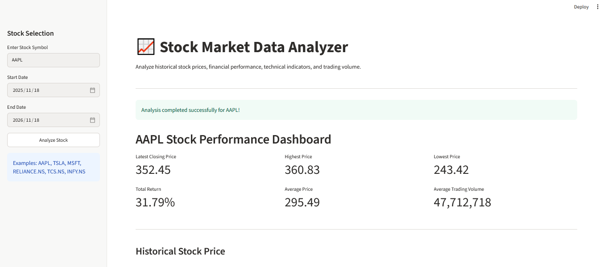
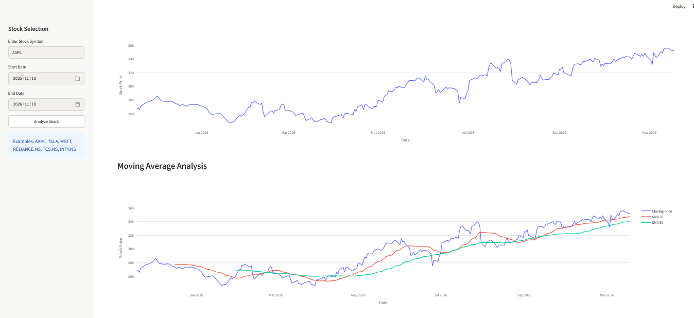
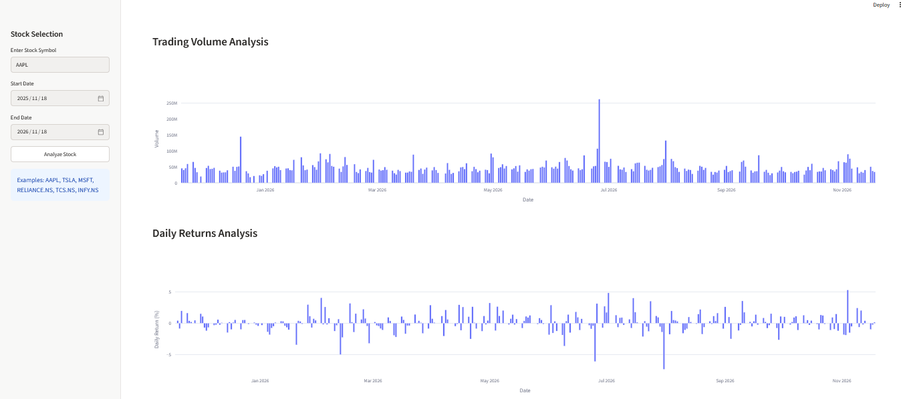
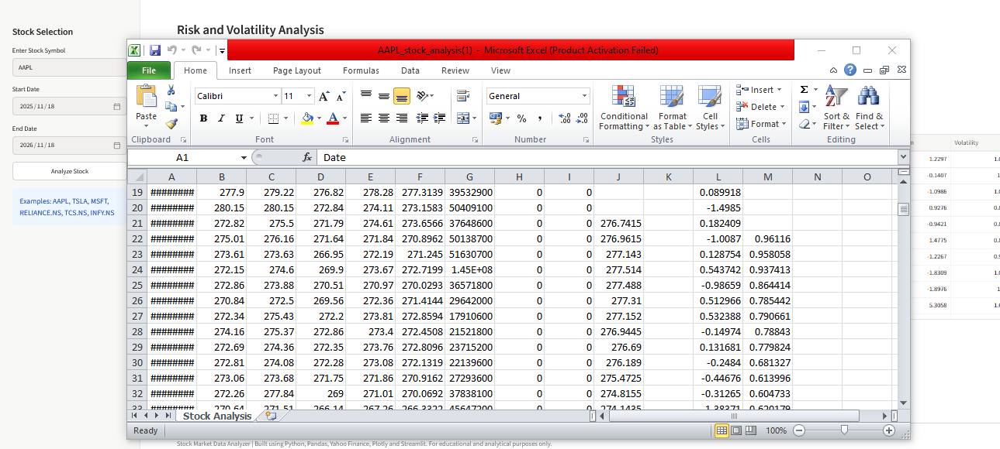

# 📈 Stock Market Data Analyzer

A Python-based stock market analysis application that collects historical stock market data, calculates financial statistics and technical indicators, and presents interactive visualizations through a Streamlit dashboard.

## 🚀 Project Overview

The Stock Market Data Analyzer helps users explore historical stock performance using publicly available market data from Yahoo Finance.

Users can enter stock symbols, select date ranges, analyze stock prices, view technical indicators, and download reports in CSV and Excel formats.

## ✨ Features

- Fetch historical stock market data using Yahoo Finance.
- Clean and preprocess stock market datasets.
- Calculate daily returns and total returns.
- Calculate 20-day and 50-day Simple Moving Averages (SMA).
- Calculate rolling volatility.
- Analyze highest, lowest, and average stock prices.
- Visualize historical prices and moving averages.
- Analyze trading volume and daily returns.
- Interactive Streamlit dashboard.
- Download analysis reports in CSV and Excel formats.

## 🛠️ Technologies Used

| Technology | Purpose |
|---|---|
| Python | Core programming |
| Pandas | Data manipulation |
| NumPy | Numerical operations |
| yfinance | Stock market data collection |
| Matplotlib | Data visualization library |
| Plotly | Interactive charts |
| Streamlit | Web dashboard |
| OpenPyXL | Excel report support |

## 📂 Project Structure

```text
Stock_Market_Data_Analyzer/
│
├── data/
│   ├── raw/
│   └── processed/
│
├── modules/
│   ├── __init__.py
│   ├── data_collector.py
│   ├── data_cleaner.py
│   ├── stock_analyzer.py
│   ├── technical_indicators.py
│   └── report_exporter.py
│
├── visualizations/
│   ├── __init__.py
│   └── charts.py
│
├── exports/
│
├── app.py
├── main.py
├── requirements.txt
├── README.md
└── .gitignore
```

## ⚙️ Installation and Setup

### 1. Clone the repository

```bash
git clone https://github.com/YOUR_USERNAME/Stock-Market-Data-Analyzer.git
```

### 2. Open the project folder

```bash
cd Stock-Market-Data-Analyzer
```

### 3. Create a virtual environment

```bash
python -m venv venv
```

### 4. Activate the virtual environment

Windows PowerShell:

```powershell
.\venv\Scripts\Activate.ps1
```

### 5. Install dependencies

```bash
pip install -r requirements.txt
```

### 6. Run the dashboard

```bash
streamlit run app.py
```

The application will open in your browser at:

`http://localhost:8501`

## 📊 Example Stock Symbols

| Company | Symbol |
|---|---|
| Apple | AAPL |
| Microsoft | MSFT |
| Tesla | TSLA |
| Reliance Industries | RELIANCE.NS |
| Tata Consultancy Services | TCS.NS |
| Infosys | INFY.NS |

## 📉 Technical Indicators

- **SMA 20:** Average closing price over the previous 20 trading sessions.
- **SMA 50:** Average closing price over the previous 50 trading sessions.
- **Daily Return:** Percentage change in closing price from the previous trading session.
- **Volatility:** Rolling standard deviation of daily returns.

## 💼 Applications

- Stock market performance analysis.
- Financial data exploration.
- Historical market trend visualization.
- Educational financial analytics.
- Python-based data analysis practice.

## 🔮 Future Enhancements

- Stock price prediction using Machine Learning.
- Portfolio performance analysis.
- Multiple stock comparison.
- Real-time market data integration.
- Automated email reports.
- Advanced technical indicators such as RSI and MACD.

## ⚠️ Disclaimer

This project is developed for educational and analytical purposes only. Market data availability and accuracy depend on the external data provider. This application does not provide financial or investment advice.

## 👩‍💻 Author

**Your Name**

GitHub: https://github.com/YOUR_USERNAME

---

⭐ If you find this project useful, consider giving the repository a star!
## 📸 Project Screenshots

### Dashboard Overview


### Technical Analysis


### Trading Volume and Returns


### Excel Report
